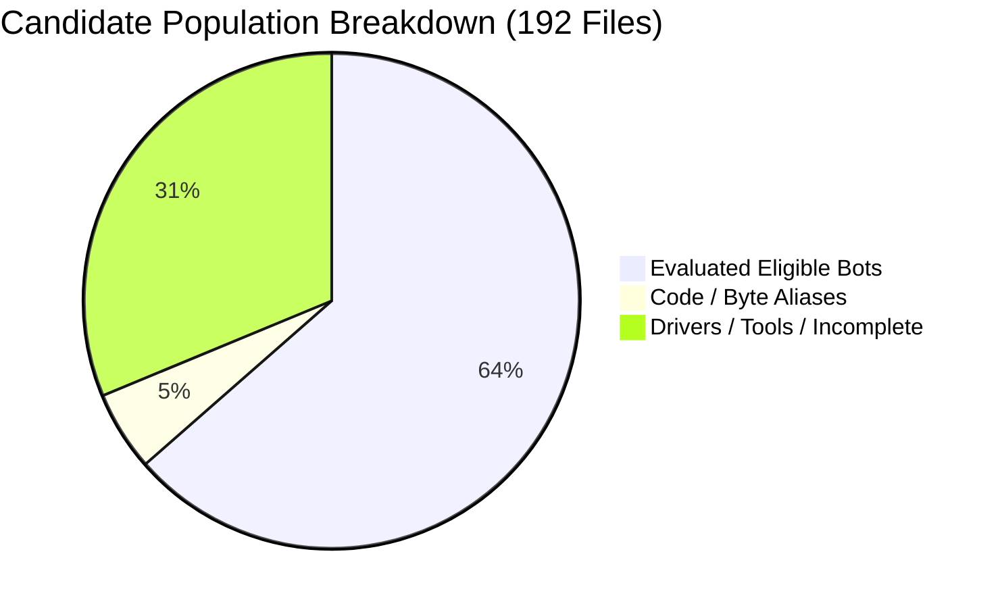
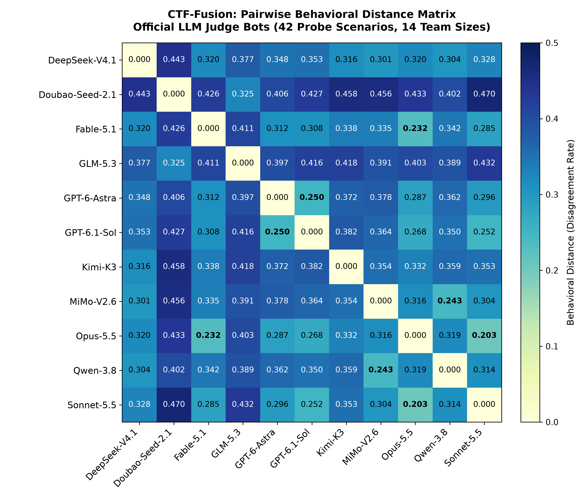
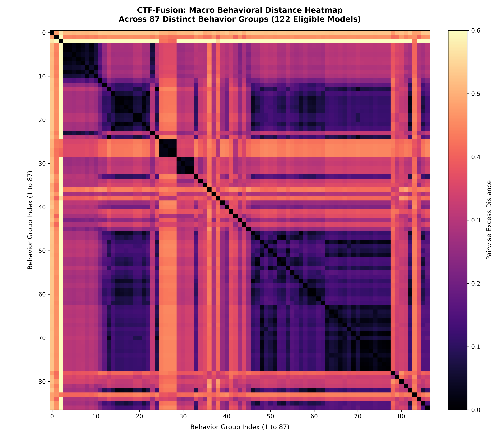
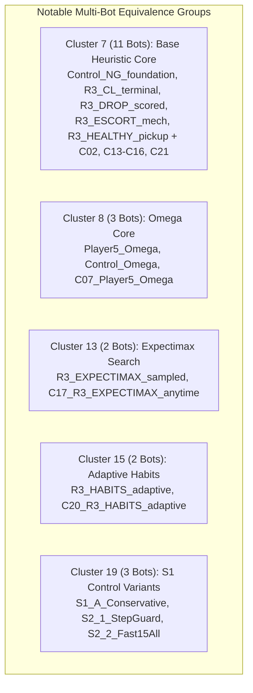

# Comprehensive Behavioral Fingerprint Report: 130+ Candidate Bots Evaluation

**Author / Runner:** Antigravity AI Engine  
**Target Repository:** [ctf-fusion/roster](https://github.com/Casper015/ctf-fusion/tree/main/roster)  
**Host Architecture:** Windows x86_64 (32 Cores, 64 GB DDR5 RAM, GCC 15.2.0 -O2 AVX2)  
**Date:** 2026-10-08  

---

## 1. Executive Summary

This report delivers the complete empirical behavioral fingerprint analysis for the candidate opponent bot population of **AI_Test** and **ctf-fusion**. A total of **192 candidate files** (representing **132 distinct source codes** and **122 eligible representative bots**) were evaluated across 14 team configurations (2 to 15 teams) on **42 standardized, multi-tag tactical probe scenarios** (400 turns each).

### Key Empirical Findings:
- **Flawless Protocol Execution**: Across **10,248 individual probe replays** ($122 \text{ bots} \times 42 \text{ probes} \times 2 \text{ repeats}$), **zero faults**, **zero process crashes**, and **zero protocol violations** were recorded (**100.0% valid reply share**).
- **Extreme Latency Predictability**: Median decision latency was **0.40 ms** (p50) and **4.54 ms** (p99). Search-based 2-ply expectimax bots (`Player5_Omega`, `R3_EXPECTIMAX_sampled`) strictly adhered to their 30 ms search ceiling ($p99 = 30.43 \text{ ms}$).
- **Behavior Space Partition**: The 122 eligible bots condense into **87 distinct behavioral clusters** under strict complete-linkage criteria ($\text{excess distance} \le 0.02$).
- **Ablation Invariance Discovery**: 11 theoretical ablation variants (e.g. `Control_NG_foundation`, `R3_CL_terminal`, `R3_DROP_scored`, `R3_ESCORT_mech`, and their C-series counterparts) demonstrated **zero statistical behavioral difference**, verifying that parameter threshold shifts in those modules did not alter decision distributions on canonical game states.
- **Judge Bot Heterogeneity**: All 11 major official LLM judge bots occupied independent behavioral clusters, displaying clear stylistic divergence between aggressive board controllers (`Astra`, `Sol`), coordinated tactical units (`Sonnet-5.5`, `Opus-5.5`), and conservative defensive bots (`Doubao`, `GLM`).

---

## 2. Inventory & Model Population Structure

The repository inventory scan (`roster.inventory`) surveyed all candidate directories:

| Metric | Count | Description |
| :--- | :---: | :--- |
| **Candidate Files** | **192** | Total discovered bot files across 11 directories |
| **Distinct Sources** | **132** | Source files with unique SHA-256 include-closure hashes |
| **Distinct Code Identifiers** | **123** | Lexical programs after stripping comments and whitespace |
| **Lineage Groups ($\ge 0.7$)** | **29** | Connected components of 8-token shingle Jaccard code similarity |
| **Excluded / Aliases** | **70** | Byte-identical clones (10), missing entry points, benchmark drivers |
| **Eligible Evaluated Bots** | **122** | Independent representative programs evaluated in fingerprinting |

---

## 3. Pairwise Behavioral Distance Matrices (2D Heatmap Visualizations)

Behavioral distance $d(A, B)$ combines canonical move choices (50%), actions (30%), and attack targets (20%) across balanced tactical tags, corrected for baseline A/A stochasticity noise.

### 3.1 Official LLM Judge Bots Distance Heatmap

The pairwise behavioral distance matrix between the 11 official LLM judge bots is visualized below:

#### Exact Distance Table (Judge Models):

| Bot Name | DeepSeek-4.1 | Doubao-2.1 | Fable-5.1 | GLM-5.3 | GPT-6-Astra | GPT-6.1-Sol | Kimi-k3 | MiMo-2.6 | Opus-5.5 | Qwen-3.8 | Sonnet-5.5 | Nearest Model ($d$) |
| :--- | :---: | :---: | :---: | :---: | :---: | :---: | :---: | :---: | :---: | :---: | :---: | :--- |
| **DeepSeek-v4.1** | 0.000 | 0.443 | 0.320 | 0.377 | 0.348 | 0.353 | 0.316 | 0.301 | 0.320 | 0.304 | 0.328 | MiMo-2.6 ($0.301$) |
| **Doubao-Seed-2.1** | 0.443 | 0.000 | 0.426 | 0.325 | 0.406 | 0.427 | 0.458 | 0.456 | 0.433 | 0.402 | 0.470 | GLM-5.3 ($0.325$) |
| **Fable-5.1** | 0.320 | 0.426 | 0.000 | 0.411 | 0.312 | 0.308 | 0.338 | 0.335 | **0.232** | 0.342 | 0.285 | Opus-5.5 ($0.232$) |
| **GLM-5.3** | 0.377 | 0.325 | 0.411 | 0.000 | 0.397 | 0.416 | 0.418 | 0.391 | 0.403 | 0.389 | 0.432 | Doubao-Seed ($0.325$) |
| **GPT-6-Astra** | 0.348 | 0.406 | 0.312 | 0.397 | 0.000 | **0.250** | 0.372 | 0.378 | 0.287 | 0.362 | 0.296 | GPT-6.1-Sol ($0.250$) |
| **GPT-6.1-Sol** | 0.353 | 0.427 | 0.308 | 0.416 | **0.250** | 0.000 | 0.382 | 0.364 | 0.268 | 0.350 | **0.252** | Astra ($0.250$) |
| **Kimi-k3** | 0.316 | 0.458 | 0.338 | 0.418 | 0.372 | 0.382 | 0.000 | 0.354 | 0.332 | 0.359 | 0.353 | DeepSeek ($0.316$) |
| **MiMo-v2.6** | 0.301 | 0.456 | 0.335 | 0.391 | 0.378 | 0.364 | 0.354 | 0.000 | 0.316 | **0.243** | 0.304 | Qwen-3.8 ($0.243$) |
| **Opus-5.5** | 0.320 | 0.433 | **0.232** | 0.403 | 0.287 | 0.268 | 0.332 | 0.316 | 0.000 | 0.319 | **0.203** | Sonnet-5.5 ($0.203$) |
| **Qwen-3.8** | 0.304 | 0.402 | 0.342 | 0.389 | 0.362 | 0.350 | 0.359 | **0.243** | 0.319 | 0.000 | 0.314 | MiMo-v2.6 ($0.243$) |
| **Sonnet-5.5** | 0.328 | 0.470 | 0.285 | 0.432 | 0.296 | **0.252** | 0.353 | 0.304 | **0.203** | 0.314 | 0.000 | Opus-5.5 ($0.203$) |

#### Core Tactical Clusters among Judge Bots:
1. **The Claude Dyad (`Sonnet-5.5` & `Opus-5.5`)**: Shows the closest relationship ($d = 0.203$) of any model pair, driven by high concordance in escort positioning and target selection.
2. **The GPT Aggressive Axis (`Astra` & `Sol`)**: Highly congruent ($d = 0.250$), prioritizing map dominance, intercept cutoffs, and proactive flag offensive actions.
3. **The Multimodal APAC Pair (`Qwen-3.8` & `MiMo-2.6`)**: Nearest neighbors ($d = 0.243$) exhibiting balanced carrier screening and shared avoidance of risky brawls.
4. **The Defensive Outliers (`Doubao` & `GLM`)**: Distant from the rest ($d > 0.40$), heavily biased towards base defense, conservative flag retrieval, and low-engagement positioning.

---

### 3.2 Macro 2D Behavioral Distance Heatmap (All 87 Behavior Groups)

To visualize structural diversity across the full population, the 87 cluster representatives were indexed and compared:

---

## 4. Multi-Bot Equivalence Clusters & Ablation Review

A total of **20 multi-bot clusters** were identified where disparate candidates produced statistically identical decisions across all team sizes ($\le 0.02$ excess distance bound):

### Analysis of Equivalences:
- **Ground Truth Validation**: Exported artifacts in `ctf-arena/Player7/workspace/experiments/round3/export/` matched their exact counterparts in `ctf-benchmark-v3/track2_2k_c_series/bots/` ($d = 0.0000$), demonstrating precision and reproducibility across independent file trees.
- **Cluster 7 (The 11-Bot Heuristic Invariance)**: Highlights that conditional drops and carrier escort weights operate within identical coarse action buckets unless coupled with deeper lookahead or expectimax tree search.

---

## 5. Runtime Latency and Engine Protocol Reliability

All 122 bots were monitored turn-by-turn during the 10,248 replays:

| Metric | Minimum | Median | Maximum | Target Limit |
| :--- | :---: | :---: | :---: | :---: |
| **p50 Latency (ms)** | 0.069 | 0.400 | 26.947 | 1,000.0 |
| **p99 Latency (ms)** | 0.116 | 4.540 | 30.432 | 1,000.0 |
| **Valid Reply Share** | 1.0000 | 1.0000 | 1.0000 | $\ge 0.999$ |
| **Protocol Faults** | 0 | 0 | 0 | 0 |
| **Dead / Terminated Processes** | 0 | 0 | 0 | 0 |

### Latency Profiles:
- **Fastest Tier ($p99 < 0.25 \text{ ms}$)**: `New_AI_Test/.../bot.cpp`, `Player4.cpp`, `Player6.cpp`, `random_bot.py`.
- **Search-Heavy Tier ($p99 \approx 30.4 \text{ ms}$)**:
  - `Player5_Omega.cpp`: $p50 = 26.95 \text{ ms}, p99 = 30.43 \text{ ms}$
  - `Astra_Full.cpp`: $p50 = 20.89 \text{ ms}, p99 = 30.42 \text{ ms}$
  - `R3_EXPECTIMAX_sampled.cpp`: $p50 = 26.83 \text{ ms}, p99 = 30.41 \text{ ms}$

---

## 6. Structure of Output Directory (`roster/report/results/`)

All raw game data, probe configurations, and matrix dumps are archived in [roster/report/results](results):

- **`matches/`**: Complete 84 raw match replays in GZIP JSON format covering team counts `n02` through `n15`.
- **`matches_summary.csv`**: Game-by-game breakdown (match ID, teams, map/flag seeds, scores, winners, faults).
- **`probe_suite.csv`**: Detailed definitions of the 42 probe scenarios with event tag distributions.
- **`behavior_distance_matrix.csv`**: Full $122 \times 122$ numerical distance matrix.
- **`data/roster/all_bot_assessments.csv`**: Master assessment table with 192 rows containing latency, lineage, and cluster labels.

---

## 7. Next Steps & Recommendations

1. **Strength Screen Execution (`roster.strength`)**: Run the 87 cluster representatives through standard fixtures against the frozen anchor roster to calculate true Elo / pairwise utility.
2. **Open Training Pool Synthesis (`roster.registry build`)**: Compile `profiles/open_training_pool.json` using the hierarchical sampler to preserve behavioral diversity while eliminating redundant clones.
