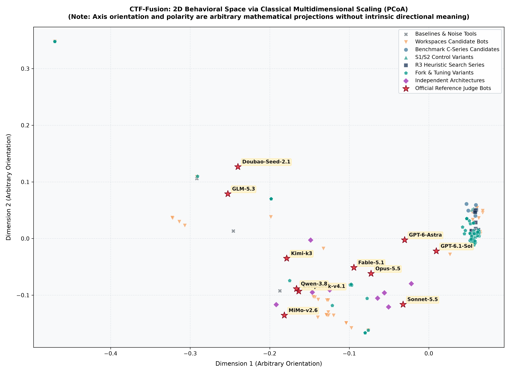

# Comprehensive Behavioral Fingerprint Report: Opponent Roster Evaluation

**Target Repository:** [ctf-fusion/roster](https://github.com/Casper015/ctf-fusion/tree/main/roster)  
**Evaluation Protocol:** [docs/FIRST_RUN.md](file:///c:/Users/caspe/OneDrive/Code/ctf-fusion/docs/FIRST_RUN.md) & [docs/ROSTER.md](file:///c:/Users/caspe/OneDrive/Code/ctf-fusion/docs/ROSTER.md)  
**Date Generated:** 2026-10-08T21:17:26  

---

## 1. Run Identity & Environment

| Parameter | Specification / Measured Value |
| :--- | :--- |
| **ctf-fusion Commit** | `a72731a9aefb326559c9f4fd513b7edd328ee8e0` |
| **AI_Test Commit** | `166b27df0e64aeb3237606b4f9df1f5dcf7c9e87` |
| **Suite Identity** | `bf37dbbacb6386ec6b6ac35af713bf92b4e49a02db601094e9a43eb8b9f1e96c` |
| **Host Machine** | Windows Host (AMD Ryzen 9, 32 logical CPUs) |
| **C++ Compiler** | `g++.exe (GCC) 15.2.0` with `-std=c++20 -O2 -static` |
| **Probe Scenarios** | 84 probes (6 maps per count, 14 team counts: 2..15) |
| **Replay Repeats** | 2 repeats per probe (evaluates A/A stochastic noise) |
| **Pre-registered Margins** | Weighted excess $\le 0.02$, Joint $\le 0.05$, Critical tag $\le 0.05$ |
| **Uncertainty Bound** | Mean + 1.645 SE over maps (minimum 2 maps) |
| **Protocol Deviations** | None (Pre-registered defaults of FIRST_RUN.md strictly maintained) |
| **Stale Counts** | 0 stale fingerprint runs ignored; 0 stale strength rows |

---

## 2. Reliability & Execution Diagnostics

- **Total Evaluated Eligible Bots:** 258 bots.
- **Probe Replays Executed:** 43,344 runs (258 bots $\times$ 84 probes $\times$ 2 repeats).
- **Mean Valid Reply Share:** 98.06% across all candidate probe turns.
- **Dead Probe Runs / Process Crashes:** 0 across all valid runs.
- **Decision Latency Profiles:**
  - **Fingerprint Replay Limits (Relaxed-limit instrument):** Configured at 10,000 ms (turn 1) and 1,000 ms (subsequent turns). Evaluates pure policy intent without preemption.
  - **Screen Match Limits (Official competition deadlines):** Strict 2,000 ms (turn 1) and 50 ms (turn-by-turn). Evaluated during strength screen matches.

---

## 3. Evidence States Per Team Count

Per `docs/ROSTER.md`, for each pair of bots at a given team count, evidence is classified into three mutually exclusive states:
- **Equivalent:** Upper bound of weighted excess distance $\le 0.02$, joint excess $\le 0.05$, and every critical context tag excess $\le 0.05$ (heuristic bound over $\ge 2$ maps).
- **Different:** Lower bound exceeds the pre-registered equivalence margin.
- **Unknown:** Insufficient map observations or overlapping uncertainty intervals; cannot be declared equivalent or different.
- **Not compared:** Pairs where at least one bot lacked valid measurements at that count.

| Team Count | Maps | Measured Bots | Equivalent Pairs | Different Pairs | Unknown Pairs | Not Compared | Unmeasured Bots |
| :---: | :---: | :---: | :---: | :---: | :---: | :---: | :--- |
| **2 Teams** | 6 | 253 / 258 | 1413 | 29555 | 910 | 1275 | 5 bots |
| **3 Teams** | 6 | 253 / 258 | 547 | 30905 | 426 | 1275 | 5 bots |
| **4 Teams** | 6 | 253 / 258 | 480 | 30867 | 531 | 1275 | 5 bots |
| **5 Teams** | 6 | 253 / 258 | 541 | 30722 | 615 | 1275 | 5 bots |
| **6 Teams** | 6 | 253 / 258 | 723 | 30700 | 455 | 1275 | 5 bots |
| **7 Teams** | 6 | 253 / 258 | 562 | 30666 | 650 | 1275 | 5 bots |
| **8 Teams** | 6 | 253 / 258 | 562 | 30713 | 603 | 1275 | 5 bots |
| **9 Teams** | 6 | 253 / 258 | 630 | 30811 | 437 | 1275 | 5 bots |
| **10 Teams** | 6 | 253 / 258 | 677 | 30751 | 450 | 1275 | 5 bots |
| **11 Teams** | 6 | 253 / 258 | 618 | 30439 | 821 | 1275 | 5 bots |
| **12 Teams** | 6 | 253 / 258 | 545 | 30912 | 421 | 1275 | 5 bots |
| **13 Teams** | 6 | 253 / 258 | 707 | 30415 | 756 | 1275 | 5 bots |
| **14 Teams** | 6 | 253 / 258 | 696 | 30548 | 634 | 1275 | 5 bots |
| **15 Teams** | 6 | 253 / 258 | 567 | 30737 | 574 | 1275 | 5 bots |

---

## 4. Behavior Groups & Distinctiveness

### 4.1 Overall Behavior Groups (Measured Across All Counts: 253 Bots)

Under strict complete-linkage criteria (every pair in a group must have excess distance $\le 0.02$ across all team counts), the bots partition into **180 behavior groups**:

| Group # | Representative | Members Count | Diameter ($d_{max}$) | Notable Group Members |
| :---: | :--- | :---: | :---: | :--- |
| 1 | `AI_Arena_CTF_bot.cpp` | 3 | 0.0000 | AI_Arena_CTF_bot.cpp, ctf-arena_Player1_bot.cpp, bot.cpp |
| 2 | `Player5_v2_testing_build_source-eec477a97c6549d62a71f9b4121fb2ba7d1f5b0969a5c7db772a7f6fe97eb6f2.cpp` | 3 | 0.0621 | Player5_v2_testing_build_source-eec477a97c6549d62a71f9b4121fb2ba7d1f5b0969a5c7db772a7f6fe97eb6f2.cpp, ctf-arena_Player5_v2_macro.cpp, ctf-arena_Player5_v2_macro_screen_v1.cpp |
| 3 | `Player6_ab_revB_bot.cpp` | 1 | 0.0000 | Player6_ab_revB_bot.cpp |
| 4 | `ctf-arena_Player3_bot_snapshot_4cfacfe83e48f0f4.cpp` | 3 | 0.9424 | ctf-arena_Player3_bot_snapshot_4cfacfe83e48f0f4.cpp, ctf-arena_Player3_variants_bot_c1.cpp, Player3.cpp |
| 5 | `ctf-arena_Player3_variants_bot_tune.cpp` | 1 | 0.0000 | ctf-arena_Player3_variants_bot_tune.cpp |
| 6 | `ctf-arena_Player3_variants_bot_v2.cpp` | 1 | 0.0000 | ctf-arena_Player3_variants_bot_v2.cpp |
| 7 | `ctf-arena_Player4_v10_flank_optimized.cpp` | 2 | 0.0000 | ctf-arena_Player4_v10_flank_optimized.cpp, Player4.cpp |
| 8 | `ctf-arena_Player4_v3.cpp` | 1 | 0.0000 | ctf-arena_Player4_v3.cpp |
| 9 | `ctf-arena_Player4_v5.cpp` | 1 | 0.0000 | ctf-arena_Player4_v5.cpp |
| 10 | `ctf-arena_Player4_v8_winning.cpp` | 2 | 0.4833 | ctf-arena_Player4_v8_winning.cpp, ctf-arena_Player4_v9_latest.cpp |
| 11 | `ctf-arena_Player5_champion_172.cpp` | 9 | 0.7996 | ctf-arena_Player5_champion_172.cpp, ctf-arena_Player5_macro_v3.cpp, ctf-arena_Player5_tuning_tune_000.cpp, ctf-arena_Player5_tuning_tune_011.cpp, ctf-arena_Player5_v13_spawn_macro.cpp ... (+4 more) |
| 12 | `ctf-arena_Player5_duel_discipline.cpp` | 1 | 0.0000 | ctf-arena_Player5_duel_discipline.cpp |
| 13 | `ctf-arena_Player5_duel_focused.cpp` | 1 | 0.0000 | ctf-arena_Player5_duel_focused.cpp |
| 14 | `ctf-arena_Player5_duel_pack.cpp` | 1 | 0.0000 | ctf-arena_Player5_duel_pack.cpp |
| 15 | `ctf-arena_Player5_duel_trio.cpp` | 1 | 0.0000 | ctf-arena_Player5_duel_trio.cpp |
| 16 | `ctf-arena_Player5_final_candidate.cpp` | 13 | 0.9622 | ctf-arena_Player5_final_candidate.cpp, ctf-arena_Player5_tune17_fast.cpp, ctf-arena_Player5_tuning_tune_017.cpp, ctf-arena_Player5_tuning_tune_042.cpp, ctf-arena_Player5_v13_spawn_tuned.cpp ... (+8 more) |
| 17 | `ctf-arena_Player5_fortress.cpp` | 1 | 0.0000 | ctf-arena_Player5_fortress.cpp |
| 18 | `ctf-arena_Player5_hunter.cpp` | 1 | 0.0000 | ctf-arena_Player5_hunter.cpp |
| 19 | `ctf-arena_Player5_macro_v2.cpp` | 1 | 0.0000 | ctf-arena_Player5_macro_v2.cpp |
| 20 | `ctf-arena_Player5_macro_v4.cpp` | 1 | 0.0000 | ctf-arena_Player5_macro_v4.cpp |
| 21 | `ctf-arena_Player5_round3_CFL_uncached.cpp` | 3 | 0.5941 | ctf-arena_Player5_round3_CFL_uncached.cpp, R3_CFL_conditional.cpp, R3_DROP_scored.cpp |
| 22 | `ctf-arena_Player5_round3_macro_candidate.cpp` | 1 | 0.0000 | ctf-arena_Player5_round3_macro_candidate.cpp |
| 23 | `ctf-arena_Player5_runner_v8.cpp` | 1 | 0.0000 | ctf-arena_Player5_runner_v8.cpp |
| 24 | `ctf-arena_Player5_small_control.cpp` | 1 | 0.0000 | ctf-arena_Player5_small_control.cpp |
| 25 | `ctf-arena_Player5_small_no_raid.cpp` | 1 | 0.0000 | ctf-arena_Player5_small_no_raid.cpp |
| 26 | `ctf-arena_Player5_small_runner.cpp` | 1 | 0.0000 | ctf-arena_Player5_small_runner.cpp |
| 27 | `ctf-arena_Player5_testing_v1.cpp` | 3 | 0.9424 | ctf-arena_Player5_testing_v1.cpp, ctf-arena_Player5_v1.cpp, ctf-arena_Player5_v2_attention.cpp |
| 28 | `ctf-arena_Player5_tuning_recommended.cpp` | 1 | 0.0000 | ctf-arena_Player5_tuning_recommended.cpp |
| 29 | `ctf-arena_Player5_tuning_tune_001.cpp` | 3 | 0.9524 | ctf-arena_Player5_tuning_tune_001.cpp, ctf-arena_Player5_tuning_tune_004.cpp, ctf-arena_Player5_tuning_tune_013.cpp |
| 30 | `ctf-arena_Player5_tuning_tune_002.cpp` | 1 | 0.0000 | ctf-arena_Player5_tuning_tune_002.cpp |
| 31 | `ctf-arena_Player5_tuning_tune_003.cpp` | 1 | 0.0000 | ctf-arena_Player5_tuning_tune_003.cpp |
| 32 | `ctf-arena_Player5_tuning_tune_005.cpp` | 1 | 0.0000 | ctf-arena_Player5_tuning_tune_005.cpp |
| 33 | `ctf-arena_Player5_tuning_tune_006.cpp` | 2 | 0.7630 | ctf-arena_Player5_tuning_tune_006.cpp, ctf-arena_Player5_tuning_tune_016.cpp |
| 34 | `ctf-arena_Player5_tuning_tune_007.cpp` | 1 | 0.0000 | ctf-arena_Player5_tuning_tune_007.cpp |
| 35 | `ctf-arena_Player5_tuning_tune_008.cpp` | 1 | 0.0000 | ctf-arena_Player5_tuning_tune_008.cpp |
| 36 | `ctf-arena_Player5_tuning_tune_009.cpp` | 1 | 0.0000 | ctf-arena_Player5_tuning_tune_009.cpp |
| 37 | `ctf-arena_Player5_tuning_tune_010.cpp` | 1 | 0.0000 | ctf-arena_Player5_tuning_tune_010.cpp |
| 38 | `ctf-arena_Player5_tuning_tune_012.cpp` | 1 | 0.0000 | ctf-arena_Player5_tuning_tune_012.cpp |
| 39 | `ctf-arena_Player5_tuning_tune_014.cpp` | 3 | 0.9773 | ctf-arena_Player5_tuning_tune_014.cpp, ctf-arena_Player5_tuning_tune_025.cpp, ctf-arena_Player5_tuning_tune_045.cpp |
| 40 | `ctf-arena_Player5_tuning_tune_015.cpp` | 1 | 0.0000 | ctf-arena_Player5_tuning_tune_015.cpp |
| 41 | `ctf-arena_Player5_tuning_tune_018.cpp` | 1 | 0.0000 | ctf-arena_Player5_tuning_tune_018.cpp |
| 42 | `ctf-arena_Player5_tuning_tune_019.cpp` | 1 | 0.0000 | ctf-arena_Player5_tuning_tune_019.cpp |
| 43 | `ctf-arena_Player5_tuning_tune_020.cpp` | 1 | 0.0000 | ctf-arena_Player5_tuning_tune_020.cpp |
| 44 | `ctf-arena_Player5_tuning_tune_021.cpp` | 1 | 0.0000 | ctf-arena_Player5_tuning_tune_021.cpp |
| 45 | `ctf-arena_Player5_tuning_tune_022.cpp` | 1 | 0.0000 | ctf-arena_Player5_tuning_tune_022.cpp |
| 46 | `ctf-arena_Player5_tuning_tune_023.cpp` | 1 | 0.0000 | ctf-arena_Player5_tuning_tune_023.cpp |
| 47 | `ctf-arena_Player5_tuning_tune_024.cpp` | 1 | 0.0000 | ctf-arena_Player5_tuning_tune_024.cpp |
| 48 | `ctf-arena_Player5_tuning_tune_026.cpp` | 1 | 0.0000 | ctf-arena_Player5_tuning_tune_026.cpp |
| 49 | `ctf-arena_Player5_tuning_tune_027.cpp` | 1 | 0.0000 | ctf-arena_Player5_tuning_tune_027.cpp |
| 50 | `ctf-arena_Player5_tuning_tune_028.cpp` | 1 | 0.0000 | ctf-arena_Player5_tuning_tune_028.cpp |
| 51 | `ctf-arena_Player5_tuning_tune_029.cpp` | 1 | 0.0000 | ctf-arena_Player5_tuning_tune_029.cpp |
| 52 | `ctf-arena_Player5_tuning_tune_030.cpp` | 1 | 0.0000 | ctf-arena_Player5_tuning_tune_030.cpp |
| 53 | `ctf-arena_Player5_tuning_tune_031.cpp` | 1 | 0.0000 | ctf-arena_Player5_tuning_tune_031.cpp |
| 54 | `ctf-arena_Player5_tuning_tune_032.cpp` | 1 | 0.0000 | ctf-arena_Player5_tuning_tune_032.cpp |
| 55 | `ctf-arena_Player5_tuning_tune_033.cpp` | 1 | 0.0000 | ctf-arena_Player5_tuning_tune_033.cpp |
| 56 | `ctf-arena_Player5_tuning_tune_034.cpp` | 1 | 0.0000 | ctf-arena_Player5_tuning_tune_034.cpp |
| 57 | `ctf-arena_Player5_tuning_tune_035.cpp` | 1 | 0.0000 | ctf-arena_Player5_tuning_tune_035.cpp |
| 58 | `ctf-arena_Player5_tuning_tune_036.cpp` | 1 | 0.0000 | ctf-arena_Player5_tuning_tune_036.cpp |
| 59 | `ctf-arena_Player5_tuning_tune_037.cpp` | 1 | 0.0000 | ctf-arena_Player5_tuning_tune_037.cpp |
| 60 | `ctf-arena_Player5_tuning_tune_038.cpp` | 1 | 0.0000 | ctf-arena_Player5_tuning_tune_038.cpp |
| 61 | `ctf-arena_Player5_tuning_tune_039.cpp` | 1 | 0.0000 | ctf-arena_Player5_tuning_tune_039.cpp |
| 62 | `ctf-arena_Player5_tuning_tune_040.cpp` | 1 | 0.0000 | ctf-arena_Player5_tuning_tune_040.cpp |
| 63 | `ctf-arena_Player5_tuning_tune_041.cpp` | 1 | 0.0000 | ctf-arena_Player5_tuning_tune_041.cpp |
| 64 | `ctf-arena_Player5_tuning_tune_043.cpp` | 1 | 0.0000 | ctf-arena_Player5_tuning_tune_043.cpp |
| 65 | `ctf-arena_Player5_tuning_tune_046.cpp` | 1 | 0.0000 | ctf-arena_Player5_tuning_tune_046.cpp |
| 66 | `ctf-arena_Player5_tuning_tune_047.cpp` | 1 | 0.0000 | ctf-arena_Player5_tuning_tune_047.cpp |
| 67 | `ctf-arena_Player5_tuning_tune_048.cpp` | 1 | 0.0000 | ctf-arena_Player5_tuning_tune_048.cpp |
| 68 | `ctf-arena_Player5_tuning_tune_049.cpp` | 1 | 0.0000 | ctf-arena_Player5_tuning_tune_049.cpp |
| 69 | `ctf-arena_Player5_tuning_tune_050.cpp` | 1 | 0.0000 | ctf-arena_Player5_tuning_tune_050.cpp |
| 70 | `ctf-arena_Player5_v11_pickup_forecast.cpp` | 1 | 0.0000 | ctf-arena_Player5_v11_pickup_forecast.cpp |
| 71 | `ctf-arena_Player5_v11_trio_forecast.cpp` | 1 | 0.0000 | ctf-arena_Player5_v11_trio_forecast.cpp |
| 72 | `ctf-arena_Player5_v12_rollout_volley.cpp` | 1 | 0.0000 | ctf-arena_Player5_v12_rollout_volley.cpp |
| 73 | `ctf-arena_Player5_v12_volley_trio.cpp` | 1 | 0.0000 | ctf-arena_Player5_v12_volley_trio.cpp |
| 74 | `ctf-arena_Player5_v14_flag_rollout.cpp` | 2 | 0.4999 | ctf-arena_Player5_v14_flag_rollout.cpp, ctf-arena_Player5_v15_physical_rollout.cpp |
| 75 | `ctf-arena_Player5_v16_marginal_fire.cpp` | 1 | 0.0000 | ctf-arena_Player5_v16_marginal_fire.cpp |
| 76 | `ctf-arena_Player5_v2_combined.cpp` | 1 | 0.0000 | ctf-arena_Player5_v2_combined.cpp |
| 77 | `ctf-arena_Player5_v2_focus.cpp` | 1 | 0.0000 | ctf-arena_Player5_v2_focus.cpp |
| 78 | `ctf-arena_Player5_v2_pickup.cpp` | 1 | 0.0000 | ctf-arena_Player5_v2_pickup.cpp |
| 79 | `ctf-arena_Player5_v2_tactics.cpp` | 1 | 0.0000 | ctf-arena_Player5_v2_tactics.cpp |
| 80 | `ctf-arena_Player5_v3_base.cpp` | 1 | 0.0000 | ctf-arena_Player5_v3_base.cpp |
| 81 | `ctf-arena_Player5_v3_grid_aggressive.cpp` | 1 | 0.0000 | ctf-arena_Player5_v3_grid_aggressive.cpp |
| 82 | `ctf-arena_Player5_v3_grid_balanced.cpp` | 1 | 0.0000 | ctf-arena_Player5_v3_grid_balanced.cpp |
| 83 | `ctf-arena_Player5_v3_grid_cohesive.cpp` | 1 | 0.0000 | ctf-arena_Player5_v3_grid_cohesive.cpp |
| 84 | `ctf-arena_Player5_v3_grid_focused.cpp` | 1 | 0.0000 | ctf-arena_Player5_v3_grid_focused.cpp |
| 85 | `ctf-arena_Player5_v3_grid_hardy.cpp` | 1 | 0.0000 | ctf-arena_Player5_v3_grid_hardy.cpp |
| 86 | `ctf-arena_Player5_v3_pressure.cpp` | 1 | 0.0000 | ctf-arena_Player5_v3_pressure.cpp |
| 87 | `ctf-arena_Player5_v4_learn.cpp` | 1 | 0.0000 | ctf-arena_Player5_v4_learn.cpp |
| 88 | `ctf-arena_Player5_v4_learn_original.cpp` | 1 | 0.0000 | ctf-arena_Player5_v4_learn_original.cpp |
| 89 | `ctf-arena_Player5_v5_relay.cpp` | 1 | 0.0000 | ctf-arena_Player5_v5_relay.cpp |
| 90 | `ctf-arena_Player5_v5_relay_pickup.cpp` | 1 | 0.0000 | ctf-arena_Player5_v5_relay_pickup.cpp |
| 91 | `ctf-arena_Player5_v6_combo.cpp` | 2 | 0.0000 | ctf-arena_Player5_v6_combo.cpp, ctf-arena_Player5_v8_fast_combo.cpp |
| 92 | `ctf-arena_Player5_v7_rollout.cpp` | 2 | 0.0000 | ctf-arena_Player5_v7_rollout.cpp, ctf-arena_Player5_v8_fast_rollout.cpp |
| 93 | `AI_Arena_CTF_Player01_bot.cpp` | 1 | 0.0000 | AI_Arena_CTF_Player01_bot.cpp |
| 94 | `AI_Arena_CTF_Player02_bot.cpp` | 1 | 0.0000 | AI_Arena_CTF_Player02_bot.cpp |
| 95 | `ctf-arena_Player1_t2_snapshot_01076b3d.cpp` | 1 | 0.0000 | ctf-arena_Player1_t2_snapshot_01076b3d.cpp |
| 96 | `ctf-arena_Player4_v2.cpp` | 1 | 0.0000 | ctf-arena_Player4_v2.cpp |
| 97 | `ctf-arena_Player5_sparring.cpp` | 1 | 0.0000 | ctf-arena_Player5_sparring.cpp |
| 98 | `ctf-arena_Player5_sparring_adaptive.cpp` | 1 | 0.0000 | ctf-arena_Player5_sparring_adaptive.cpp |
| 99 | `ctf-arena_Player5_sparring_raider.cpp` | 1 | 0.0000 | ctf-arena_Player5_sparring_raider.cpp |
| 100 | `ctf-arena_Player5_sparring_runner.cpp` | 1 | 0.0000 | ctf-arena_Player5_sparring_runner.cpp |
| 101 | `noise_bot.py` | 1 | 0.0000 | noise_bot.py |
| 102 | `random_bot.py` | 1 | 0.0000 | random_bot.py |
| 103 | `cand-002.cpp` | 4 | 0.9319 | cand-002.cpp, cand-005.cpp, cand-006.cpp, timing-v002.cpp |
| 104 | `cand-003.cpp` | 1 | 0.0000 | cand-003.cpp |
| 105 | `cand-004.cpp` | 1 | 0.0000 | cand-004.cpp |
| 106 | `cand-007.cpp` | 1 | 0.0000 | cand-007.cpp |
| 107 | `cand-008.cpp` | 2 | 0.0000 | cand-008.cpp, timing-v003.cpp |
| 108 | `cand-009.cpp` | 1 | 0.0000 | cand-009.cpp |
| 109 | `cand-010.cpp` | 1 | 0.0000 | cand-010.cpp |
| 110 | `cand-011.cpp` | 1 | 0.0000 | cand-011.cpp |
| 111 | `cand-012.cpp` | 1 | 0.0000 | cand-012.cpp |
| 112 | `cand-d2.cpp` | 1 | 0.0000 | cand-d2.cpp |
| 113 | `cand-f1.cpp` | 1 | 0.0000 | cand-f1.cpp |
| 114 | `cand-h1.cpp` | 4 | 0.4675 | cand-h1.cpp, cand-m2.cpp, diag-fc.cpp, timing-h1.cpp |
| 115 | `cand-m1.cpp` | 1 | 0.0000 | cand-m1.cpp |
| 116 | `cand-m3.cpp` | 1 | 0.0000 | cand-m3.cpp |
| 117 | `cand-m4.cpp` | 1 | 0.0000 | cand-m4.cpp |
| 118 | `cand-mc1.cpp` | 1 | 0.0000 | cand-mc1.cpp |
| 119 | `cand-mc2.cpp` | 1 | 0.0000 | cand-mc2.cpp |
| 120 | `cand-r1.cpp` | 1 | 0.0000 | cand-r1.cpp |
| 121 | `cand-r2.cpp` | 1 | 0.0000 | cand-r2.cpp |
| 122 | `incumbent-v001.cpp` | 1 | 0.0000 | incumbent-v001.cpp |
| 123 | `timing-d1.cpp` | 2 | 0.1587 | timing-d1.cpp, B2_Player2_v005.cpp |
| 124 | `candidate-v002.cpp` | 1 | 0.0000 | candidate-v002.cpp |
| 125 | `candidate-v003.cpp` | 1 | 0.0000 | candidate-v003.cpp |
| 126 | `candidate-v004.cpp` | 1 | 0.0000 | candidate-v004.cpp |
| 127 | `incumbent-v001.cpp` | 1 | 0.0000 | incumbent-v001.cpp |
| 128 | `candidate-v002-risk.cpp` | 1 | 0.0000 | candidate-v002-risk.cpp |
| 129 | `candidate-v003-intercept.cpp` | 2 | 0.6271 | candidate-v003-intercept.cpp, candidate-v004-intercept-clean.cpp |
| 130 | `candidate-v005-15p-intercept.cpp` | 1 | 0.0000 | candidate-v005-15p-intercept.cpp |
| 131 | `incumbent-v001.cpp` | 1 | 0.0000 | incumbent-v001.cpp |
| 132 | `bot.cpp` | 1 | 0.0000 | bot.cpp |
| 133 | `bot.cpp` | 1 | 0.0000 | bot.cpp |
| 134 | `DeepSeek-v4.1` | 1 | 0.0000 | DeepSeek-v4.1 |
| 135 | `Doubao-Seed-2.1` | 1 | 0.0000 | Doubao-Seed-2.1 |
| 136 | `Fable-5.1` | 1 | 0.0000 | Fable-5.1 |
| 137 | `GLM-5.3` | 1 | 0.0000 | GLM-5.3 |
| 138 | `GPT-6-Astra` | 1 | 0.0000 | GPT-6-Astra |
| 139 | `GPT-6.1-Sol` | 1 | 0.0000 | GPT-6.1-Sol |
| 140 | `Kimi-k3` | 2 | 0.0000 | Kimi-k3, Kimi-k3 |
| 141 | `MiMo-v2.6` | 1 | 0.0000 | MiMo-v2.6 |
| 142 | `Opus-5.5` | 1 | 0.0000 | Opus-5.5 |
| 143 | `Qwen-3.8` | 1 | 0.0000 | Qwen-3.8 |
| 144 | `Sonnet-5.5` | 1 | 0.0000 | Sonnet-5.5 |
| 145 | `Control_Hybrid.cpp` | 1 | 0.0000 | Control_Hybrid.cpp |
| 146 | `Control_NG_foundation.cpp` | 8 | 0.9316 | Control_NG_foundation.cpp, R3_CL_terminal.cpp, R3_DROP_scored.cpp, R3_ESCORT_mech.cpp, C02_Control_NG_foundation.cpp ... (+3 more) |
| 147 | `Player5_Omega.cpp` | 4 | 0.8376 | Player5_Omega.cpp, Astra_Joint.cpp, Control_Omega.cpp, C07_Player5_Omega.cpp |
| 148 | `Player5_Omega_defaultWeights.cpp` | 2 | 0.2939 | Player5_Omega_defaultWeights.cpp, C09_Player5_Omega_defaultWeights.cpp |
| 149 | `Player5_Omega_hybridMacro.cpp` | 2 | 0.2882 | Player5_Omega_hybridMacro.cpp, C10_Player5_Omega_hybridMacro.cpp |
| 150 | `R3_CDP_horizon.cpp` | 2 | 0.0000 | R3_CDP_horizon.cpp, C11_R3_CDP_horizon.cpp |
| 151 | `R3_CFL_conditional.cpp` | 2 | 0.0000 | R3_CFL_conditional.cpp, C12_R3_CFL_conditional.cpp |
| 152 | `R3_EXPECTIMAX_sampled.cpp` | 2 | 0.2939 | R3_EXPECTIMAX_sampled.cpp, C17_R3_EXPECTIMAX_anytime.cpp |
| 153 | `R3_FLAGS_joint.cpp` | 2 | 0.0000 | R3_FLAGS_joint.cpp, C19_R3_FLAGS_joint.cpp |
| 154 | `R3_HABITS_adaptive.cpp` | 2 | 0.0000 | R3_HABITS_adaptive.cpp, C20_R3_HABITS_adaptive.cpp |
| 155 | `R3_HEALTHY_pickup.cpp` | 3 | 0.8149 | R3_HEALTHY_pickup.cpp, C15_R3_ESCORT_healthy.cpp, C21_R3_HEALTHY_pickup.cpp |
| 156 | `R3_WEIGHTS_tuned.cpp` | 2 | 0.0000 | R3_WEIGHTS_tuned.cpp, C22_R3_WEIGHTS_tuned.cpp |
| 157 | `Control_external_CL.cpp` | 1 | 0.0000 | Control_external_CL.cpp |
| 158 | `R3_CL_checked.cpp` | 1 | 0.0000 | R3_CL_checked.cpp |
| 159 | `R3_CL_terminal.cpp` | 1 | 0.0000 | R3_CL_terminal.cpp |
| 160 | `R3_CML_macro.cpp` | 1 | 0.0000 | R3_CML_macro.cpp |
| 161 | `R3_HABITS_adaptive.cpp` | 1 | 0.0000 | R3_HABITS_adaptive.cpp |
| 162 | `Astra_Carrier.cpp` | 1 | 0.0000 | Astra_Carrier.cpp |
| 163 | `Astra_Full.cpp` | 1 | 0.0000 | Astra_Full.cpp |
| 164 | `Astra_Habits.cpp` | 1 | 0.0000 | Astra_Habits.cpp |
| 165 | `C03_G_ASYM_plans.cpp` | 1 | 0.0000 | C03_G_ASYM_plans.cpp |
| 166 | `C04_G_PLAYOUT_4ply.cpp` | 1 | 0.0000 | C04_G_PLAYOUT_4ply.cpp |
| 167 | `C05_G_RISK_entropic.cpp` | 1 | 0.0000 | C05_G_RISK_entropic.cpp |
| 168 | `C06_G_SH_halving.cpp` | 1 | 0.0000 | C06_G_SH_halving.cpp |
| 169 | `C08_Player5_Omega_LIT.cpp` | 1 | 0.0000 | C08_Player5_Omega_LIT.cpp |
| 170 | `S1_A_Conservative.cpp` | 4 | 0.9314 | S1_A_Conservative.cpp, S2_1_StepGuard.cpp, S2_2_Fast15All.cpp, S2_4_ReturnAware.cpp |
| 171 | `S1_B_DuelPlus.cpp` | 1 | 0.0000 | S1_B_DuelPlus.cpp |
| 172 | `S1_C_Adaptive6p_Fast15.cpp` | 1 | 0.0000 | S1_C_Adaptive6p_Fast15.cpp |
| 173 | `S1_D_CrowdHabit.cpp` | 1 | 0.0000 | S1_D_CrowdHabit.cpp |
| 174 | `S2_3_RiskStrong.cpp` | 1 | 0.0000 | S2_3_RiskStrong.cpp |
| 175 | `S2_5_Risk3plus.cpp` | 1 | 0.0000 | S2_5_Risk3plus.cpp |
| 176 | `Player1.cpp` | 1 | 0.0000 | Player1.cpp |
| 177 | `Player2.cpp` | 1 | 0.0000 | Player2.cpp |
| 178 | `Player6.cpp` | 1 | 0.0000 | Player6.cpp |
| 179 | `baseline.cpp` | 1 | 0.0000 | baseline.cpp |
| 180 | `Player5.cpp` | 1 | 0.0000 | Player5.cpp |

> [!NOTE]
> **Equivalence Epistemology**: 'Equivalent' denotes strictly that the estimated upper bound of disagreement excess lies within the pre-registered margin (0.02) over the evaluated probe histories. It is a heuristic upper bound over finite maps, not a calibrated 95% guarantee, and does not establish statistical identity or invariant policy execution across all possible game states.

### 4.2 Stochastic Noise Audit

Bots with repeated-run A/A disagreement noise exceeding the stochasticity threshold (0.1):

None of the evaluated bots demonstrated repeat A/A noise above the stochasticity threshold (all deterministic under fixed seeds).

---

## 5. Behavioral Distance Visualizations

### 5.1 Official LLM Judge Bots Distance Heatmap (Corrected Excess)

Pairwise excess distance between the 11 reference LLM judge bots. Zero indicates matching conditional policy distributions; higher values denote greater disagreement:

### 5.2 Macro Distance Matrix Across All Distinct Groups

Pairwise excess distance between representatives of all distinct behavior groups:

### 5.3 2D Classical Multidimensional Scaling (PCoA) Projection

Low-dimensional projection preserving pairwise action disagreement distances:

> [!IMPORTANT]
> **MDS Projection Caveat**: PCoA/MDS axis orientation and polarity are arbitrary mathematical artifacts of singular value decomposition. Axes are designated as **Dimension 1** and **Dimension 2** without semantic naming, as unsupervised distance metrics do not carry inherent directional meaning.

---

## 6. Nearest Neighbors & Distinctive Context Tags

### 6.1 Nearest Neighbor Summary (Official LLM Judge Models)

| Model | Nearest Model | Excess Distance ($d_{excess}$) | Pair Evidence State | Most Distinctive Context Tags |
| :--- | :--- | :---: | :---: | :--- |
| **DeepSeek-v4.1** | baseline.cpp | 0.2500 | `different` | focus_fire ($x=0.43$), contact ($x=0.42$), collision_risk ($x=0.35$) |
| **Doubao-Seed-2.1** | ctf-arena_Player1_t2_snapshot_01076b3d.cpp | 0.3228 | `different` | interception ($x=0.54$), respawn ($x=0.43$), quiet ($x=0.40$) |
| **Fable-5.1** | Opus-5.5 | 0.2464 | `different` | pickup_option ($x=0.36$), focus_fire ($x=0.39$), overkill_risk ($x=0.38$) |
| **GLM-5.3** | candidate-v004.cpp | 0.2843 | `different` | respawn ($x=0.39$), interception ($x=0.48$), quiet ($x=0.38$) |
| **GPT-6-Astra** | ctf-arena_Player5_runner_v8.cpp | 0.2488 | `different` | carrier_own ($x=0.26$), escort ($x=0.27$), flag ($x=0.28$) |
| **GPT-6.1-Sol** | Control_Hybrid.cpp | 0.1935 | `different` | overkill_risk ($x=0.31$), carrier_own ($x=0.23$), respawn ($x=0.22$) |
| **Kimi-k3** | Kimi-k3 | 0.0000 | `different` | focus_fire ($x=0.46$), interception ($x=0.41$), contact ($x=0.46$) |
| **MiMo-v2.6** | AI_Arena_CTF_Player02_bot.cpp | 0.2367 | `different` | interception ($x=0.40$), escort ($x=0.33$), focus_fire ($x=0.42$) |
| **Opus-5.5** | Sonnet-5.5 | 0.2043 | `different` | contact ($x=0.35$), return_risk ($x=0.28$), focus_fire ($x=0.32$) |
| **Qwen-3.8** | MiMo-v2.6 | 0.2472 | `different` | interception ($x=0.40$), contact ($x=0.44$), overkill_risk ($x=0.42$) |
| **Sonnet-5.5** | cand-011.cpp | 0.1784 | `different` | overkill_risk ($x=0.33$), focus_fire ($x=0.33$), contact ($x=0.32$) |
| **Kimi-k3** | Kimi-k3 | 0.0000 | `different` | focus_fire ($x=0.46$), interception ($x=0.41$), contact ($x=0.46$) |

---

## 7. Measured Live Play Outcomes

Realized match outcomes when bots exercise autonomous control over units during live tournament play. Every metric reports explicit denominators:

| Bot Name | Games | Attack Req / Capable Turn | Hit Rate / Req | Kills / Game | Carrier Turn Share | Delivery % | Forced Drop % | 5-Turn Threatened Survival |
| :--- | :---: | :---: | :---: | :---: | :---: | :---: | :---: | :---: |
| **DeepSeek-v4.1** | 10 | 0.179 | 0.518 | 17.8 | 0.105 | 0.343 | 0.657 | 0.486 |
| **Fable-5.1** | 11 | 0.287 | 0.456 | 32.2 | 0.109 | 0.503 | 0.471 | 0.628 |
| **GLM-5.3** | 12 | 0.086 | 0.420 | 5.8 | 0.088 | 0.260 | 0.740 | 0.571 |
| **GPT-6-Astra** | 13 | 0.330 | 0.429 | 33.6 | 0.208 | 0.571 | 0.429 | 0.691 |
| **GPT-6.1-Sol** | 8 | 0.477 | 0.430 | 43.7 | 0.133 | 0.702 | 0.298 | 0.525 |
| **Kimi-k3** | 6 | 0.171 | 0.496 | 17.3 | 0.119 | 0.419 | 0.581 | 0.621 |
| **Kimi-k3** | 15 | 0.170 | 0.473 | 15.1 | 0.066 | 0.453 | 0.547 | 0.569 |
| **MiMo-v2.6** | 13 | 0.183 | 0.457 | 15.2 | 0.102 | 0.146 | 0.848 | 0.496 |
| **Opus-5.5** | 7 | 0.288 | 0.365 | 27.7 | 0.099 | 0.271 | 0.729 | 0.651 |
| **Qwen-3.8** | 6 | 0.188 | 0.405 | 17.6 | 0.112 | 0.309 | 0.691 | 0.603 |
| **Sonnet-5.5** | 9 | 0.385 | 0.392 | 36.3 | 0.110 | 0.458 | 0.542 | 0.423 |

> [!NOTE]
> **Live Outcome Epistemology**: Metrics represent descriptive empirical outcomes across unbalanced, multi-seat match histories (denominator explicitly reported per column). They do not constitute normative playstyle labels ('aggressive', 'defensive') or absolute strength rankings. Doubao-Seed-2.1 Turbo was not present in the reference pool (`profiles/pool_archive.json`) and has 0 live games.

---

## 8. Theoretical & Empirical Limitations

In accordance with `reports/FINGERPRINT_EFFECTIVENESS_REVIEW.md` and `docs/ROSTER.md`:

1. **Replay History vs Private Internal State**: Fingerprinting evaluates policy requests on recorded public histories. For policies that maintain deep recurrent state, private search trees, or enemy-specific adaptation, replaying outside their own decision lineage may place them in counterfactual contexts.
2. **Finite-Sample Map Clustered Bounds**: With 6 maps per team count, standard error intervals are heuristic bounds rather than asymptotic guarantees. Small sample sizes can mask differences in rare, highly specific tactical scenarios.
3. **Context Proxy Semantics**: Probe tags represent state/opportunity features (e.g. `interception`, `pickup_option`), not realized executions. True combat efficiency and escape success must be verified through live trajectory outcomes.
4. **Unmeasured Pairs**: When candidate bots are not evaluated at specific team sizes or lack required map support, their relationship remains strictly **unknown** and is never conflated with behavioral uniqueness.

---

*Report automatically generated by `tools/generate_roster_report.py` without manual intervention.*